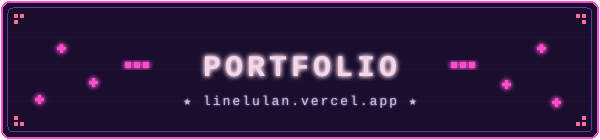
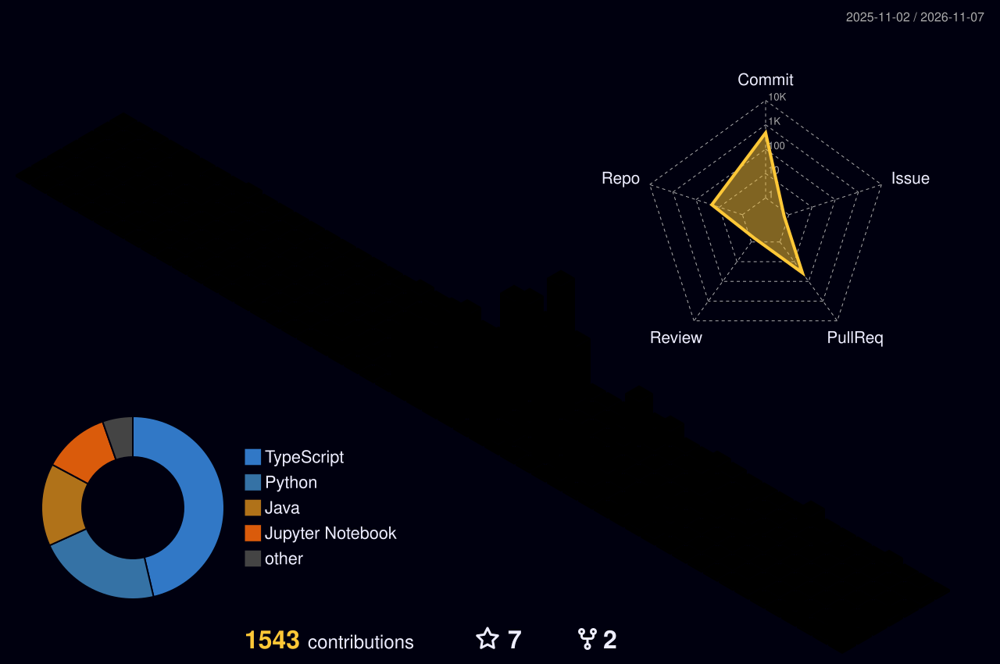

<!-- ========== ANIMATED PIXEL-ART BANNER ========== -->

<!-- ========== AVATAR (animated, clickable) ========== -->

# *— Chill in coding, feel in styling —*

> 💬 **`[ System ]`** :: A wandering star compiled into your timeline. You've reached the lofi mainframe of **Trần Nam Anh (Line)** — *Data Engineer* by daylight, *clinical ML researcher* by twilight, *agent-harness tinkerer* when the constellations align. *Press any key to continue…*

 

<h3 align="center">✦ ＳＹＳＴＥＭ ／ ＩＤＥＮＴＩＴＹ ✦</h3>

<table>
  <tr><td>◆ <b>CLASS</b></td><td><code>::</code></td><td><code>Data Engineer</code> @ <b>Twohearts Technologies</b> &nbsp;·&nbsp; KFC F&amp;B Track winner</td></tr>
  <tr><td>◆ <b>RESEARCH</b></td><td><code>::</code></td><td><code>Lead AI Researcher</code> · dengue shock prediction @ <b>HTD HCMC × IU</b></td></tr>
  <tr><td>◆ <b>GUILD</b></td><td><code>::</code></td><td><code>Co-founder</code> @ <b>100B Studio</b> &nbsp;|&nbsp; <code>Advisor</code> @ <a href="https://www.facebook.com/gdgoc.hcmiu"><b>GDGoC HCMIU</b></a></td></tr>
  <tr><td>◆ <b>ACADEMY</b></td><td><code>::</code></td><td><code>BSc Data Science</code> @ <b>International University, VNU-HCM</b> · 2023 – 2028</td></tr>
  <tr><td>◆ <b>BASE</b></td><td><code>::</code></td><td><code>Ho Chi Minh City</code> · GMT+7 · open to AI / ML &amp; data roles</td></tr>
</table>

 

<h3 align="center">✦ ＦＥＡＴＵＲＥＤ ／ ＱＵＥＳＴＳ ✦</h3>

<table>
  <tr>
    <td width="50%" valign="top">
      <h4>🪐 GoiBERT-M</h4>
      <code>research</code> · <code>co-first author</code>
      
Compact Vietnamese encoders by two-stage knowledge distillation. GoiBERT-large averages <b>81.13</b> on eight benchmarks, above PhoBERT-v2, at about half the parameters.

      
      
    </td>
    <td width="50%" valign="top">
      <h4>🛰️ Line Harness</h4>
      <code>agent coding</code> · <code>solo builder</code>
      
My daily agent-coding harness: Claude Code plans and reviews, Codex CLI implements, hooks enforce the rules. A three-layer review gate caught <b>504 defects</b> across 328 ledgered tasks.

      
    </td>
  </tr>
  <tr>
    <td width="50%" valign="top">
      <h4>💳 CreditMiner</h4>
      <code>data mining</code> · <code>team leader</code>
      
Predicts credit-card default on 30,000 clients and explains why: Weka models, K-means personas, Apriori rules and GSP sequences behind a Spring Boot API and a Next.js dashboard.

      
      
    </td>
    <td width="50%" valign="top">
      <h4>🔭 Panic Hub</h4>
      <code>agentic simulation</code>
      
A real-time agentic AI simulation game with <b>50+ concurrent LLM-driven agents</b>, modelling how panic spreads through a synthetic society.

      
    </td>
  </tr>
  <tr>
    <td width="50%" valign="top">
      <h4>📊 Ezidatic</h4>
      <code>AI data analyst</code>
      
Instant EDA, AutoML and an agent that talks to your data.

      
    </td>
    <td width="50%" valign="top">
      <h4>🌏 EnStudy-Hub</h4>
      <code>edtech</code> · <code>live</code>
      
An FSRS-powered vocabulary trainer for Vietnamese English learners, with four review minigames.

      
    </td>
  </tr>
</table>

Every project has a full story, method and results on <a href="https://linelulan.vercel.app/#work">linelulan.vercel.app</a>.

 

<h3 align="center">[ ／／ A R S E N A L _ S T A C K ／／ ]</h3>

<b>AGENTIC CODING</b> 
    

<b>LLMS IN PRODUCTION</b> 
   

<b>ML &amp; DATA</b> 
     

<b>SHIP &amp; RUN</b> 
    

 

<h3 align="center">✦ ＴＲＯＰＨＹ ／ ＣＡＢＩＮＥＴ ✦</h3>

<table>
  <tr><td>🏆</td><td><b>KFC F&amp;B Track Winner</b> · Agentic AI Build Week, GenAI Fund</td><td><code>Jul 2026</code></td></tr>
  <tr><td>📄</td><td><b>GoiBERT preprint</b> on arXiv · co-first author</td><td><code>Oct 2026</code></td></tr>
  <tr><td>🎤</td><td><b>Speaker</b> · Swift Conference Vietnam</td><td><code>Apr 2026</code></td></tr>
  <tr><td>🎓</td><td><b>Academic Encouragement Scholarship</b> × 2 · IU VNU-HCM</td><td><code>2026</code></td></tr>
  <tr><td>🥉</td><td><b>3rd Place</b> · IU AI Competition</td><td><code>Dec 2025</code></td></tr>
</table>

 

<h3 align="center">[ ／／ T E L E M E T R Y _ F E E D ／／ ]</h3>

  
  

 

<h3 align="center">[ ／／ C O N T R I B _ S K Y L I N E ／／ ]</h3>

  

 

<h3 align="center">[ ／／ C O M M I T _ S E R P E N T ／／ ]</h3>

  

 

<h3 align="center">[ ／／ C O N N E C T _ P R O T O C O L ／／ ]</h3>

  
  
  
  
  

 

  

 

> *"Every shooting star is a commit pushed into the void."*

`// connection closed by stellaris`

